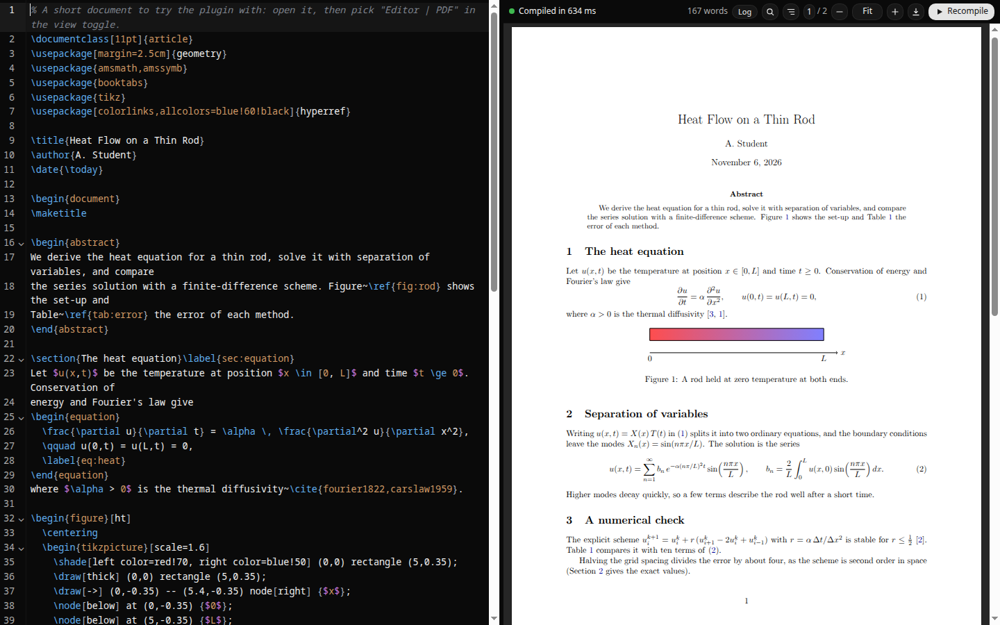

# LaTeX Preview for Orca



Adds two views to every `.tex` file, in the editor's view toggle next to Source and Changes:

- **Editor | PDF**: the source on the left and the compiled PDF on the right.
  The PDF rebuilds a moment after you stop typing, from your unsaved text; saving is not
  needed. Drag the divider to resize it (double-click resets it to half).
- **PDF**: the compiled document alone.

Both compile with the TeX installation on your machine.

## Features

- Compiles the unsaved buffer over the project files: `\input`, `\include`, images and `.bib`
  files come from the project folder, and what you are editing comes from the editor.
- Writes nothing into your project. The PDF and auxiliary files go to
  `~/.cache/orca-latex-preview/`, unless you set **Output folder**.
- Uses latexmk when it is installed. Otherwise it runs the engine itself, then BibTeX or Biber
  when the document has a bibliography, and reruns until cross-references settle (at most 4
  passes).
- Picks the engine from a `% !TEX program = xelatex` comment, or from the preamble (fontspec,
  unicode-math or polyglossia means XeLaTeX), or from the setting.
- Follows `% !TEX root = ../main.tex` in included files, so a chapter's PDF view shows the whole
  document.
- Rebuilds when other project files change on disk, for example a figure regenerated by a script
  or an agent's edit.
- Lists errors and warnings with the file and line they come from, also for warnings and
  overfull boxes in `\input` files. In Editor | PDF, a click on one in this file moves the
  cursor to its line (lines with errors are shaded); one in another file opens that file.
- **Precompiled preamble** (pdfLaTeX): the packages before `\begin{document}` are loaded once and
  saved, so each rebuild starts from there. On a 49-page paper a build went from 1.3 s to 0.65 s.
  It needs the `mylatexformat` package (in a full TeX Live; on Fedora
  `sudo dnf install texlive-mylatexformat`, on Debian and Ubuntu it is in `texlive-latex-extra`);
  without it builds run as before. The format is rebuilt when the preamble or a local package it
  loads changes, and dropped when it causes errors a normal build does not have.
- Keeps your place in the PDF across rebuilds, and in the PDF and the source (with the split
  between them) when you switch tabs and come back. Zoom with the buttons, Ctrl+scroll, Ctrl+= and
  Ctrl+-; Ctrl+0 fits the page width. Internal links (table of contents, `\ref`, citations)
  jump within the PDF. Ctrl+Enter recompiles. The save button exports the PDF.

## Navigation and writing aids

- **Source and PDF jumps (SyncTeX).** In Editor | PDF, double-click a word in the source to show
  its line in the PDF, marked for a moment (Ctrl+Alt+J does the same for the cursor's line).
  Double-click the PDF to put the cursor on the line that produced it. When that line is in
  another file of the project (an `\input` chapter), Orca opens that file, and its Editor | PDF
  view goes to the line.
- **Select and copy text in the PDF** by dragging over it.
- **Find in the PDF.** Ctrl+F (outside the source pane, where Ctrl+F searches the source) or the
  magnifier button opens a search bar. Matches are highlighted on every page; Enter and
  Shift+Enter step through them. The search follows rebuilds.
- **Page number.** Type a page number in the toolbar and press Enter to go there; the arrow keys
  step a page.
- **Outline.** The list button opens the document's parts, chapters and sections, across
  `\input` and `\include` files. Choosing one scrolls the PDF there and, for this file, moves
  the cursor.
- **Autocomplete.** `\ref{`, `\eqref{` and `\cref{` offer the project's labels; `\cite{` and
  its natbib and biblatex forms offer the keys of the bibliography (with author, year and
  title); `\begin{` inserts the environment with its `\end`, and `\end{` closes the open one;
  `\usepackage{` lists common packages; `\includegraphics{`, `\input{` and `\bibliography{`
  list the project's files; and commands complete, including the ones the project defines with
  `\newcommand`.
- **References and citations on hover.** Hover a `\ref` key to see what it names (`figure: A plot
  of results`, its number and page from the last build, and where the label is), or a `\cite`
  key for the title, authors, year and venue. Keys with no `\label`, or missing from the
  bibliography, are underlined.
- **Editing help.** Enter after `\begin{itemize}` (or any environment) writes the matching
  `\end`. Environments and sections fold from the gutter. Typing a block name alone at the start
  of a line (`figure`, `table`, `equation`, `align`, `itemize`, `enumerate`, `subfigures`,
  `frame`) offers the whole block, with fields to fill.
- **Word count** in the toolbar: words in the document body, counting text, headings and
  captions, but not math, commands or comments.
- **LaTeX colors** for commands, environment names, arguments and comments, in light and dark.

## How the plugin finds the file

Orca gives plugin editors the text of a document but never its path. To compile, the plugin
needs the folder, so it compares the text with the `.tex` files of your workspaces and
takes the matching file (or, for a buffer with unsaved edits, the clearly most similar one). When
it cannot tell, it lists the candidates and asks.

### Workspaces on SSH hosts

The build always runs on this machine, with its TeX. For a workspace on an SSH host, the plugin
copies the files a build can read (`.tex`, `.bib`, styles, figures, data files for plots, up to
50 MB each, skipping hidden folders and `node_modules`) into `~/.cache/orca-latex-preview/remote/`,
compiles that copy, and copies again every few seconds while a view of the document is on
screen, so a file saved on the host rebuilds the PDF (and one deleted there is deleted from the
copy). Unsaved edits come from the editor as usual, and Orca saves them to the host as it does any
file. A copy no view has used for two weeks is deleted.

The PDF goes back to the host: after a build without errors from saved files, the plugin writes
it next to the main `.tex` file there (`notebook.pdf` beside `notebook.tex`), replacing the one
there, so the host's PDF always matches the host's sources. The status line says **Syncing to
server…**, then **Synced to server**, or **Syncs to server on save** while there are unsaved
edits; after a build with errors it says **Not synced (errors)** and the host keeps the last good
PDF; a failed upload shows as **Not synced**, with the reason on hover. That PDF is the only
file the plugin writes on the host. Turn off **Copy the PDF to the SSH host** to keep the PDF on
this machine only.

It connects with your own OpenSSH client (`ssh`, and `rsync` when both machines have it, else
`tar`), using the host settings Orca saved: a host imported from `~/.ssh/config` is reached by
its alias. The connection must work without a prompt, through a key without a passphrase or a
running ssh-agent. The first copy of a large project takes a few seconds.

When Orca runs its own server on the SSH host (an environment, such as one Orca sets up when you
add the host), that server keeps the workspaces, and plugins are not given them. The plugin then
asks the `orca` CLI (`orca-ide` on Linux) for each environment's workspaces and copies them the
same way. A click on an issue or outline entry in another file of such a workspace cannot open
that file; it still works within the open file.

## Requirements

- Orca 1.4.248 or newer, desktop app, on Linux, macOS or Windows.
- A TeX distribution with the packages your documents use. Everything else (the PDF viewer, the
  editor) ships with the plugin. TeX does not: a usable TeX Live is several gigabytes.

When something is missing, the view says what, why, and how to install it on this computer, with
a Copy button for the command; the plugin log (`orca plugin logs`) carries the same as
`[requirement]` lines. It covers TeX itself, an engine (XeLaTeX, LuaLaTeX), BibTeX and Biber, a
missing LaTeX package, a missing system font, shell escape for minted, and Pygments, and tells a
missing package apart from a missing project file.

The command follows where your TeX came from, then your system:

| TeX | Adds packages with |
| --- | --- |
| MiKTeX (Windows, macOS, Linux) | MiKTeX itself: on-the-fly installs, or `miktex packages install` |
| TeX Live from tug.org, MacTeX, BasicTeX, TinyTeX | `tlmgr` (with `sudo` when installed for all users) |
| Homebrew's `texlive` (macOS) | Homebrew (it has every package) |
| Nix | your TeX Live set (`texlive.withPackages`) |
| Your Linux distribution's TeX | the system package manager: dnf, apt (with `apt-file`), pacman, zypper, emerge, apk, xbps, eopkg, rpm-ostree on image-based Fedora |

Installing TeX in the first place:

| System | Suggested |
| --- | --- |
| Windows | `winget install MiKTeX.MiKTeX`, or the MiKTeX or TeX Live installer |
| macOS | `brew install --cask mactex-no-gui`, or MacTeX (BasicTeX is smaller) |
| Fedora, RHEL and relatives | `sudo dnf install texlive-scheme-medium texlive-latexmk` |
| Fedora Silverblue and other image-based systems | `rpm-ostree install …`, or TinyTeX in your home folder |
| Debian, Ubuntu, Mint, Pop!_OS | `sudo apt install texlive-latex-recommended texlive-latex-extra texlive-fonts-recommended latexmk` |
| Arch, Manjaro, EndeavourOS | `sudo pacman -S texlive-basic texlive-latex texlive-latexrecommended texlive-latexextra texlive-fontsrecommended texlive-binextra` |
| openSUSE | `sudo zypper install texlive-scheme-medium texlive-latexmk` |
| Gentoo, Alpine, Void, Solus, NixOS | their own packages (the view gives the command) |
| Any other Linux | TinyTeX, which needs no root |

The plugin finds TeX on Orca's PATH and in the usual install folders even when a desktop
launcher hides them: `/Library/TeX/texbin` and Homebrew on macOS; MiKTeX's and TeX Live's folders
on Windows; `/usr/local/texlive`, TinyTeX and Nix profiles on Linux. If yours is elsewhere, set
**Extra TeX bin folder** in the plugin settings. If Orca runs as a Flatpak or Snap it cannot see
the system's TeX; the view says so and suggests TinyTeX in your home folder.

## Settings

| Setting | Default | |
| --- | --- | --- |
| TeX engine | Auto | Auto, pdfLaTeX, XeLaTeX or LuaLaTeX |
| Use latexmk when installed | on | |
| Compile as you type | on | Off means only the Recompile button builds |
| Delay before compiling | 400 ms | Pause after the last change |
| Output folder | empty | Relative to the main file; empty uses Orca's cache |
| Precompile the preamble | on | pdfLaTeX with mylatexformat; otherwise ignored |
| Allow shell escape | off | Needed by minted; lets the document run commands |
| Copy the PDF to the SSH host | on | For documents on an SSH host; writes the PDF beside the main file there |
| Run the project's latexmkrc | off | Lets latexmk run a `latexmkrc` in the document's folder (Perl); your own `~/.latexmkrc` is always read |
| Extra TeX bin folder | empty | Searched before PATH |

## Limitations

- Orca draws every plugin view in the toggle with the same pen icon; hover to see which is
  **Editor | PDF** and which is **PDF**.
- The source pane of Editor | PDF is CodeMirror inside the plugin, not Orca's own editor, so
  Orca's editor features (its keybindings, multi-cursor settings, agent annotations) are not
  there. Edits go into Orca's buffer, so dirty state, Ctrl+S, the tab and the other views stay
  in sync.
- Orca opens another project file in its default editor; the jump to the line happens in that
  file's Editor | PDF view (open now, or switched to within a minute). Orca's own text editor
  cannot be told a line.
- Opening other files needs the "Open your workspaces and their files" permission, which Orca
  asks for when installing or updating.
- Workspaces on paired Orca runtimes are not supported. SSH workspaces are, through a local copy
  (see above), which needs `ssh` on this machine and a login that does not prompt. Orca does not
  give plugins a host's connection settings, so the plugin reads the SSH hosts saved in Orca's
  profile; a future Orca that stores them differently would break this until the plugin follows.

## Development

```sh
orca plugin dev watch .                      # load this folder and stream its logs
orca plugin validate .
orca plugin shot . --editor path/to/file.tex # screenshot the Editor | PDF view
orca plugin dev request . latex.diagnostics  # builds, sessions and tools the worker sees
npm test                                     # node --test: unit tests, and a real build when TeX is installed
```

`examples/demo/` is a short document to try the views with. GitHub Actions runs the tests on
Linux, macOS and Windows, and builds the test project with TeX Live on Ubuntu.

- `worker/`: the Node worker. `main.mjs` holds sessions, builds, file location and watching;
  `compile.mjs` the build steps; `synctex.mjs` source and PDF positions; `project.mjs` outline,
  labels, bibliography, commands and word count; `logparse.mjs` log parsing; `preamble.mjs`
  precompiled preambles; `requirements.mjs` what to install; `discover.mjs` document, root and
  engine detection; `tools.mjs` executable lookup; `remote.mjs` copies of SSH workspaces.
- `editor/`: the two views. `split.html` and `pdf.html` share `app.js` (document sync and the
  worker session), `viewer.js` (pdf.js viewer with text selection and find), `source-editor.js` (CodeMirror),
  `latex-tools.js` (hovers, undefined keys, `\end` on Enter, folding) and `completions.js`.
- Vendored: pdf.js 4.10.38 (Apache-2.0) in `editor/vendor/pdfjs`, and a CodeMirror 6 bundle
  (MIT) with the stex mode in `editor/vendor/codemirror.mjs`. pdf.js ships without its
  character maps and standard font files: TeX output embeds its fonts, and the plugin store
  does not accept binary files.

## License

MIT. pdf.js is Apache-2.0; CodeMirror is MIT.
